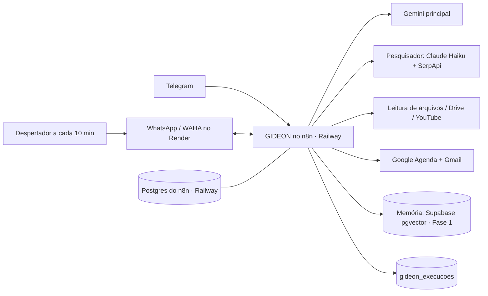

# Arquitetura — estado atual (06/11/2026)

Itens marcados ⚠ ainda precisam de confirmação do dono.

## O que mudou em 06/11/2026

A instância do n8n Cloud (`mauriciosrn8n.app.n8n.cloud`) **não existe mais**, e os workflows que rodavam nela se perderam sem export. O orquestrador passou a ser um n8n próprio no Railway (decisão 007). Tudo que dependia de workflow precisa ser reconstruído.

## Peças

| Peça | O que é | Onde roda | Situação |
| --- | --- | --- | --- |
| n8n (orquestrador) | n8n self-hosted, imagem oficial `n8nio/n8n` | Railway, projeto `gideon-n8n`, https://n8n-production-a0ba2.up.railway.app | ✅ No ar desde 06/11; conta de dono criada |
| Supabase `gideon` | Memória, tarefas, lembretes, aprovações, ações, ponte com o PC e diário de bordo; plano grátis, us-east-1, ref `ntgsrfqmlaocxjelvnef` (ver `supabase/README.md`) | Supabase | ✅ No ar; n8n conecta com o usuário `gideon_n8n` |
| Postgres do n8n | Guarda workflows, credenciais e execuções (volume persistente, rede privada) | Railway, mesmo projeto | ✅ No ar |
| n8n Cloud antigo | Antigo orquestrador | `mauriciosrn8n.app.n8n.cloud` | ❌ Instância não existe |
| GIDEON - Telegram - Conversa | Telegram → filtro "Só o dono" → GIDEON (Gemini `gemini-3.5-flash-lite` + memória das últimas 10 mensagens) → Telegram | n8n Railway | ✅ Ativo e testado em 06/11 (resposta em ~1 s) |
| GIDEON - Núcleo - Atender pedido | Cérebro único que todo canal chama: busca na memória → agente (Gemini + ferramentas de lembretes e tarefas) → guarda a conversa → registra a execução | n8n Railway | ✅ Ativo e testado em 06/11 (~2 s) |
| GIDEON - Memória - Guardar / Buscar | Sub-workflows da memória (vetores `gemini-embedding-2`, 768 dimensões, no Supabase) | n8n Railway | ✅ Ativos e testados |
| GIDEON - Lembretes - Disparar | A cada minuto envia no Telegram os lembretes vencidos (com repetição diária, semanal ou mensal) | n8n Railway | ✅ Ativo |
| GIDEON - Sistema - Relatório semanal | Domingo 19h: pedidos, sucesso, tempo, custo, erros, memórias novas | n8n Railway | ✅ Ativo; texto testado sem enviar |
| GIDEON - Telegram - Canal | Novo canal do Telegram que usa o Núcleo (substitui o "Conversa") | n8n Railway | ⏸ Criado e **desligado**: aguarda OK do dono para a troca |
| GIDEON - Sistema - Alerta de erro | Error Trigger → aviso no Telegram do dono | n8n Railway | ✅ Ativo; ligado ao workflow da conversa |
| Jarvis - Fase 1 (antigo) | Telegram → Claude → Telegram | n8n Cloud antigo | ❌ Perdido; substituído pelo GIDEON - Telegram - Conversa |
| WAHA | API de WhatsApp (repositório `MauricioSUprir/jarvis-waha`) | Render grátis, https://jarvis-waha.onrender.com | ⚠ Serviço separado, deve existir; sem o Despertador, dorme |
| Jarvis - Despertador WhatsApp | Acorda o WAHA a cada 10 min | n8n Cloud antigo | ❌ Perdido; reconstruir |
| Ferramenta "WhatsApp - Enviar mensagem" | Ligada ao assistente | n8n Cloud antigo | ❌ Perdida; reconstruir |
| Gemini | Modelo principal (`gemini-3.5-flash-lite`) | API | ✅ Credencial cadastrada no n8n novo |
| Pesquisador | Claude Haiku + SerpApi | n8n Cloud antigo / API | ❌ Workflow perdido; chaves a cadastrar |
| Leitura de arquivos | PDF, Word, PowerPoint, Excel, fotos, vídeos, YouTube, links | n8n Cloud antigo | ❌ Perdida; reconstruir |
| Google Agenda e Gmail | Inclui posts do Classroom que chegam por e-mail | n8n Cloud antigo | ❌ Credenciais a refazer no n8n novo |
| Memória simples antiga | Tabelas `jarvis_memoria`, `jarvis_tarefas`, `jarvis_lembretes` | n8n Cloud antigo | ❌ Perdidas; substituídas pelas tabelas `gideon_*` no Supabase |

## Como vai conversar (alvo)

## Custos e limites (plano B obrigatório)

- **Railway (n8n + Postgres):** plano Hobby, US$ 5/mês com US$ 5 de uso incluso; estimativa de US$ 5 a 10/mês. Conta: `gui.drodrigues21@gmail.com`. Região: `sfo` (EUA). Volume do Postgres: 500 MB.
- ⚠ Render grátis (WAHA): o serviço dorme sem tráfego, por isso o Despertador. Plano B: mover o WAHA para o mesmo projeto do Railway.
- ⚠ Limites do plano grátis do Gemini e da SerpApi: a levantar e registrar aqui.

## Acesso do Claude

- API do n8n: chave `claude-gideon`, guardada como segredo de rede do ambiente `gideon` do Claude Code (não está no Git nem em variável). Para trocar: apagar a chave no n8n, criar outra e salvar pelo formulário seguro.
- Railway: conector do Railway na conta do Claude.

## Backup

- Workflows: export JSON em `n8n/workflows/` (sem credenciais) a cada mudança.
- `N8N_ENCRYPTION_KEY`: fica só nas variáveis do Railway (serviço `n8n`). O dono deve guardar uma cópia num gerenciador de senhas; sem ela as credenciais salvas no n8n não podem ser lidas depois de uma restauração.
- Banco: o Postgres fica num volume do Railway; ativar backups do volume no painel do Railway.

## Pendências de levantamento

- Prompt de sistema que o assistente usava (o que o dono lembrar) para `prompts/`.
- Confirmar se o WAHA no Render ainda está de pé.
- A memória curta da conversa (últimas 10 mensagens) fica no n8n e se perde quando ele reinicia; a memória de longo prazo fica no Supabase e não se perde.
