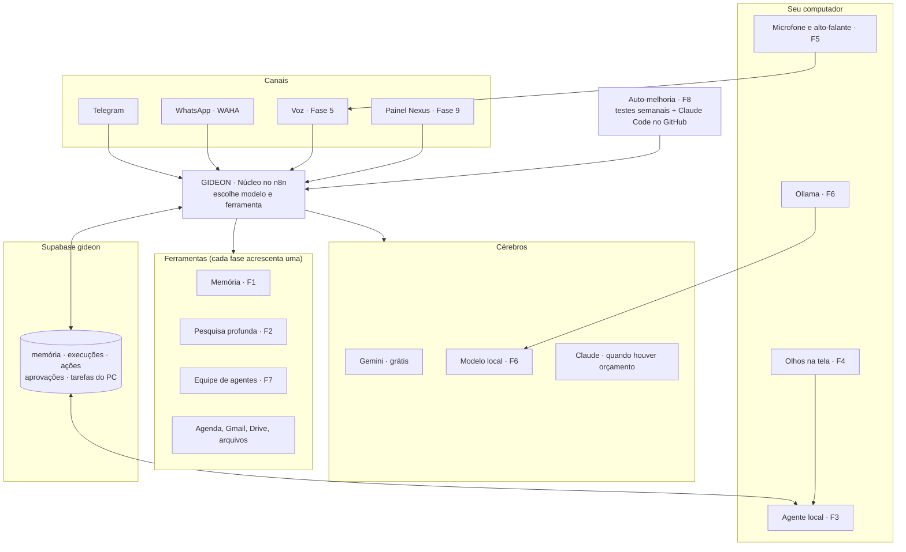

# GIDEON — Plano completo: os 9 projetos e como tudo se junta

*06/11/2026 · Orçamento: zero por enquanto (decisão 009) · Leia junto com `roadmap.md` e `regras-qualidade.md`*

## A ideia em uma frase

O GIDEON é **um só assistente** com um núcleo central. Cada um dos 9 projetos entra como **uma ferramenta nova** desse núcleo. A integração acontece **a cada fase**, não só no final: quando a última fase terminar, tudo já estará ligado.

---

## 1. A espinha dorsal (o que liga tudo)

São cinco peças que todos os projetos compartilham. Elas existem antes de qualquer projeto novo.

| Peça | O que é | Onde fica | Situação |
| --- | --- | --- | --- |
| **Núcleo** | Workflow `GIDEON - Núcleo - Atender pedido`. Todo canal manda o pedido para ele, e ele decide qual modelo e qual ferramenta usar | n8n | Hoje é o `GIDEON - Telegram - Conversa`; vira o Núcleo na Fase 1 |
| **Memória única** | Banco com tudo o que o GIDEON sabe e já fez | Supabase `gideon` (pgvector) | Projeto criado |
| **Diário de bordo** | `gideon_execucoes` (cada pedido) + `gideon_acoes` (cada ação feita no mundo, para desfazer) | Supabase `gideon` | `gideon_execucoes` criada |
| **Fila de aprovações** | `gideon_aprovacoes`: tudo que precisa do seu OK (apagar, enviar, pagar) | Supabase + botões no Telegram + painel | Fase 1 |
| **Ponte com o PC** | `gideon_tarefas_pc`: o n8n escreve a ordem, o agente no PC lê, executa e devolve o resultado | Supabase (tempo real) | Fase 3 |

### Contrato único de ferramenta

Toda ferramenta (memória, pesquisa, PC, tela, equipe...) é um sub-workflow que **recebe e devolve sempre o mesmo formato**. É isso que permite juntar tudo sem retrabalho:

```
Entrada:  { pedido, canal, usuario, contexto }
Saída:    { resposta, fontes[], status: sucesso|erro|precisa_aprovacao, custo, tempo_ms }
```

### Por que a ponte com o PC passa pelo Supabase

O n8n na nuvem não alcança o seu computador. Em vez de abrir uma porta no PC (arriscado), o **PC é quem pergunta**: o agente local fica escutando a tabela `gideon_tarefas_pc` e só executa o que estiver lá. Isso tem três vantagens: custo zero, nada exposto na internet e todo pedido registrado.

---

## 2. Como fica no final



**Exemplo de um pedido com tudo ligado:** você fala "GIDEON, pesquisa sobre X e guarda no projeto Y".
1. O microfone capta o pedido e o Whisper transcreve no PC.
2. O texto chega ao Núcleo, que chama a Pesquisa profunda (Gemini lendo as páginas).
3. O relatório é salvo na Memória e no Drive.
4. O pedido entra no diário de bordo, e o painel mostra o resultado.
5. O GIDEON responde falando.

---

## 3. Os 9 projetos, um por um

Cada projeto tem uma pasta no repositório, uma ferramenta no Núcleo e um critério de pronto.

### Fase 1 — Universal Memory (`memoria/`)
- **O que faz:** guarda tudo com data, origem e projeto; você pergunta e ele acha.
- **Peças:**
  - tabelas `gideon_memoria` (texto + vetor) e `gideon_arquivos` (impressão digital de cada arquivo, para não processar duas vezes);
  - workflows `GIDEON - Memória - Indexar`, `GIDEON - Memória - Buscar` e `GIDEON - Memória - Vigiar Drive`.
- **Grátis:** Supabase grátis + embeddings do Gemini (plano grátis).
- **Liga no Núcleo como:** ferramentas `buscar_memoria` e `guardar_memoria`. Todo pedido passa a gravar um resumo.
- **Também entra aqui:**
  - o Núcleo de verdade (roteador de modelos + registro em `gideon_execucoes`);
  - o relatório semanal de domingo;
  - os botões Útil e Não útil;
  - a reconstrução de agenda, Gmail e leitura de arquivos, que se perderam.
- **Pronto quando:** "onde está o projeto que comecei em agosto?" volta o arquivo certo, com link.

### Fase 2 — Deep Research (`pesquisa/`)
- **O que faz:** planeja as perguntas, busca, lê as páginas inteiras, cruza as fontes e entrega um relatório com links.
- **Peças:** workflow `GIDEON - Pesquisa - Profunda`, com sub-etapas para planejar, buscar, ler, cruzar e escrever.
- **Grátis:** Gemini com busca do Google (cota grátis) + leitura de páginas. A SerpApi fica opcional (100 buscas por mês grátis).
- **Liga no Núcleo como:** ferramenta `pesquisar`. O resultado vai para a Memória e para o Drive.
- **Pronto quando:** um pedido no Telegram devolve um relatório com fontes clicáveis, salvo no Drive e na memória.

### Fase 3 — Jarvis Prime: mãos no PC (`agente-local/`)
- **O que faz:** abre aplicativos, organiza arquivos e roda comandos no seu computador.
- **Peças:**
  - o programa `agente-local` (pequeno, em Python), instalado no PC, que escuta `gideon_tarefas_pc`;
  - uma **pasta liberada**, a única que ele pode alterar;
  - log de cada ação em `gideon_acoes`.
- **Grátis:** código próprio + Supabase. O Claude Desktop com uso do computador entra como opção extra.
- **Liga no Núcleo como:** ferramenta `pc_executar`. Ações perigosas passam por `gideon_aprovacoes` antes.
- **Pronto quando:** "organiza a pasta X e prepara o projeto Y" roda inteiro, pedindo OK antes de apagar.
- **Antes de começar:** as regras de segurança (`docs/seguranca.md`) e os primeiros testes numa máquina virtual.

### Fase 4 — Screen Intelligence (`agente-local/tela/`)
- **O que faz:** um atalho de teclado tira um print, o Gemini explica, e a resposta chega no Telegram.
- **Peças:** atalho no PC → agente local → webhook do n8n → Gemini (visão) → Telegram.
- **Grátis:** visão do Gemini (plano grátis).
- **Liga no Núcleo como:** ferramenta `ver_tela`, que depois vira **os olhos** do Jarvis Prime.
- **Pronto quando:** o print de um erro volta com a causa e o próximo passo.

### Fase 5 — Voice OS (`voz/`)
- **O que faz:** você diz "GIDEON", fala o pedido e ele responde falando.
- **Peças:**
  - palavra de ativação com openWakeWord (treinada para "GIDEON");
  - transcrição com whisper.cpp, no PC;
  - voz com Kokoro, no PC;
  - envio do texto ao Núcleo.
- **Grátis:** tudo local e open source. A ElevenLabs fica para quando houver orçamento.
- **Liga no Núcleo como:** novo **canal** (`canal = voz`), como o Telegram.
- **Pronto quando:** "abre meu editor e mostra os erros do projeto mais recente" funciona falado.

### Fase 6 — Neural Core (`cerebro-local/`)
- **O que faz:** modelos rodando no seu PC para assuntos privados e tarefas simples, com custo zero.
- **Peças:** Ollama + Open WebUI no PC; o agente local repassa ao Ollama o que o Núcleo marcar como "privado".
- **Grátis:** tudo local. O tamanho do modelo depende da sua placa de vídeo, que ainda falta informar.
- **Liga no Núcleo como:** terceiro cérebro no roteador de modelos (regra: privado → local).
- **Pronto quando:** um pedido marcado como privado é respondido sem sair do PC, com o registro dizendo `modelo = local`.

### Fase 7 — AI Company (`equipe/`)
- **O que faz:** um Diretor divide a tarefa entre 4 especialistas: Pesquisador, Programador, Revisor e Escritor.
- **Peças:** cada especialista é um sub-workflow (agente como ferramenta), com o prompt em `prompts/`.
- **Grátis:** Gemini. Com orçamento, o Programador e o Revisor podem usar Claude.
- **Liga no Núcleo como:** ferramenta `equipe`. O plano do Diretor passa pela fila de aprovações antes de executar.
- **Pronto quando:** uma tarefa de vários passos sai com plano aprovado, execução e revisão registradas.

### Fase 8 — Self-Improving (`testes/` + GitHub)
- **O que faz:** toda semana roda cerca de 30 pedidos reais, dá nota, e propõe correções que só entram com o seu OK.
- **Peças:**
  - workflow `GIDEON - Sistema - Bateria de testes` (domingo);
  - tabela `gideon_avaliacoes`;
  - o Claude Code abre uma proposta de mudança no GitHub com os workflows exportados.
- **Grátis:** Gemini como avaliador + GitHub.
- **Liga no Núcleo como:** usa o próprio Núcleo para testar, e as correções viram novas versões dos workflows.
- **Pronto quando:** o relatório semanal traz a nota e uma correção proposta, aplicada só após OK.

### Fase 9 — Nexus OS: o painel (`painel/`)
- **O que faz:** um painel web com conversas, memória, tarefas, status dos agentes e aprovações pendentes.
- **Peças:** site com login, lendo o Supabase, e uma caixa de conversa que fala com o Núcleo.
- **Grátis:** site estático no Render (não gasta a cota de horas) + Supabase Auth.
- **Liga no Núcleo como:** novo **canal** (`canal = painel`), e é **a tela onde tudo aparece junto**.
- **Pronto quando:** você aprova uma ação pendente pelo painel e ela é executada.

---

## 4. Ordem e marcos

| Etapa | O que fica pronto | Depende de |
| --- | --- | --- |
| 0 — Base | n8n no ar, Telegram, alerta de erro, Supabase, `gideon_execucoes` | ✅ quase pronto (falta a hospedagem grátis) |
| 1 — Memória | Núcleo + memória + agenda, Gmail e arquivos de volta + relatório semanal | Base |
| 2 — Pesquisa | Relatórios com fontes | Memória |
| 3 — Mãos no PC | Agente local com pasta liberada e aprovações | Memória + saber qual é o seu PC |
| 4 — Visão de tela | Atalho de print → explicação | Agente local |
| 5 — Voz | Fala e ouve, no PC | Agente local |
| 6 — Cérebro local | Ollama para o que for privado | Agente local + placa de vídeo |
| 7 — Equipe | Diretor + 4 especialistas | Pesquisa + Memória |
| 8 — Auto-melhoria | Testes semanais + correções propostas | Histórico de uso (semanas de uso real) |
| 9 — Painel | Tudo numa tela | Todas as tabelas acima |

Regra: **uma fase por vez**. A próxima só começa quando o critério de pronto da atual passa e você aprova (`regras-qualidade.md`, seção 5).

---

## 5. Custo zero: o que isso significa na prática

| Item | Opção grátis | Limite ou cuidado |
| --- | --- | --- |
| Servidor do n8n | ⚠ **Em decisão.** O Railway é pago depois do teste e o Render não comporta. Proposta: Hugging Face Spaces (grátis, 16 GB de RAM) com o banco do n8n no Supabase | Dorme após 48 h sem uso; o Telegram o acorda |
| Banco e memória | Supabase grátis | 500 MB; pausa após 7 dias sem uso (o uso diário evita) |
| Cérebro | Gemini, plano grátis | Limite de pedidos por minuto e por dia. **No plano grátis, o Google pode usar os dados para melhorar os produtos dele**: assunto privado vai para o modelo local (Fase 6) |
| Pesquisa | Gemini com busca do Google; SerpApi grátis (100 por mês) | Cotas |
| Voz | whisper.cpp + Kokoro, no PC | Usa o processador do PC |
| PC, tela e cérebro local | Open source no seu PC | Depende do hardware |
| WhatsApp | WAHA no Render grátis | Divide a cota de 750 h/mês com os seus outros 7 serviços |

---

## 6. O que falta você decidir ou informar

1. **Servidor grátis do n8n:** posso preparar no Hugging Face? Para isso você cria uma conta (de preferência com o e-mail novo do projeto).
2. **Seu computador:** Windows ou Mac, quanta memória RAM e qual placa de vídeo (necessário a partir da Fase 3).
3. **Lista do que o GIDEON pode fazer sem perguntar** (necessária a partir da Fase 3).
4. **Repositório `gideon`:** liberar o acesso do Claude em https://github.com/apps/claude/installations/select_target
