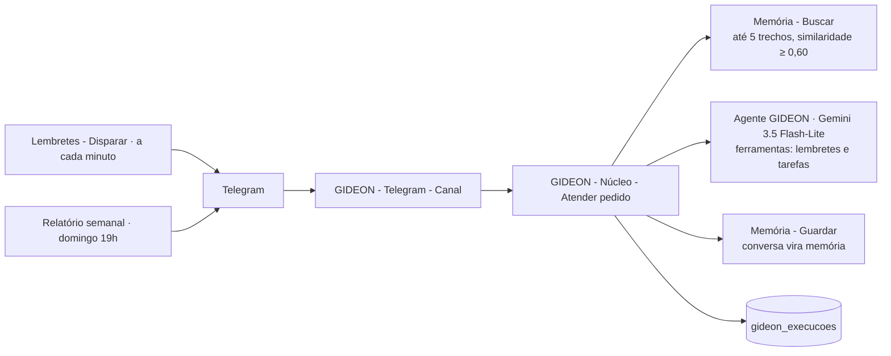

# Fase 1 — Universal Memory

Tudo que entra no GIDEON vai para um banco vetorial com data, origem e projeto.
**Pronto quando:** "onde está aquele projeto que comecei em agosto?" volta o arquivo certo, com link e histórico.

**Situação (06/11/2026):** em andamento. Memória, Núcleo, lembretes, tarefas, registro e relatório prontos e testados. Faltam: ligar o novo canal do Telegram (precisa do OK do dono), Google (Drive, Gmail, Agenda) e arquivos.

## Decisões
- [x] Banco da memória: Supabase, projeto `gideon` (decisão 009)
- [x] Orçamento: zero por enquanto (decisão 009)
- [ ] Computador do dono (só para as Fases 3 e 6)
- [ ] O que o GIDEON pode fazer sem perguntar (só a partir da Fase 3)

## Como funciona

- Vetores: `gemini-embedding-2` com 768 dimensões (plano grátis do Gemini).
- Documento guardado como `title: <projeto> | text: <conteúdo>`; pergunta buscada como `task: search result | query: <pergunta>` (o modelo não aceita `task_type`, a tarefa vai no texto).
- Textos longos são cortados em trechos de 1.200 caracteres (150 de sobreposição, máx. 50 trechos); cada trecho tem uma impressão digital e não é gravado duas vezes.
- Calibragem (06/11): pergunta relacionada → 0,78; sem relação → 0,51. Limite usado: **0,60**.

## Checklist da Fase 1

**A. Base de medição (regras de qualidade)**
- [x] A1. Tabela `gideon_execucoes` (Supabase, migração 001)
- [x] A2. Registro de execução: nó "Registrar execução" dentro do Núcleo (todo canal passa por ele)
- [x] A3. `GIDEON - Sistema - Alerta de erro` (Error Trigger → Telegram), ligado a todos os workflows
- [x] A4. `GIDEON - Sistema - Relatório semanal` (domingo 19h) — testado sem enviar
- [ ] A5. Botões "Útil / Não útil" nas respostas importantes

**B. Banco**
- [x] B1. Projeto `gideon` no Supabase com pgvector
- [x] B2. Tabelas `gideon_memoria` e `gideon_arquivos` (migração 002)
- [x] B3. Função `gideon_buscar_memoria` (até 5 trechos, filtros de projeto, tipo e data)
- [x] B4. `gideon_tarefas` e `gideon_lembretes` (substituem as `jarvis_*` perdidas)
- [x] B5. Usuário `gideon_n8n` com acesso só às tabelas do GIDEON (migração 004)

**C. Indexação**
- [x] C1. `GIDEON - Memória - Guardar` (texto → trechos → impressão digital → vetor → grava; não duplica)
- [ ] C2. Indexar a pasta do Drive (precisa da credencial Google no n8n)
- [ ] C3. Ler arquivos enviados no Telegram (PDF, Word, Excel, fotos) e guardar
- [x] C4. Guardar conversas automaticamente (todo pedido vira memória do tipo `conversa`)

**D. Busca e Núcleo**
- [x] D1. `GIDEON - Memória - Buscar` (~0,4 s)
- [x] D2. `GIDEON - Núcleo - Atender pedido`: busca na memória antes de responder, ferramentas de lembretes e tarefas
- [ ] D3. Trocar `GIDEON - Telegram - Conversa` por `GIDEON - Telegram - Canal` (já criado, desligado; **precisa do OK do dono**)
- [ ] D4. Reconstruir Google Agenda e Gmail como ferramentas do Núcleo

**E. Teste e aprovação**
- [x] E1. Teste interno: "quando começou o projeto da loja?" → respondeu certo pela memória (06/11)
- [ ] E1b. Mesmo teste com um arquivo real do Drive, com link
- [ ] E2. Mínimo de 10 pedidos reais em `testes/tarefas-reais.md`, com sucesso acima de 90%
- [ ] E3. Checklist de revisão de fase (`docs/regras-qualidade.md`, seção 5) e uso do dono por 3 dias

**F. Nomes (decisão 006)**
- [x] F1. Workflows antigos "Jarvis - ..." se perderam; todos os novos usam `GIDEON - ...`
- [ ] F2. Nome do bot no Telegram (no @BotFather, se o dono quiser)
- [x] F3. Tabelas novas são `gideon_*`; as `jarvis_*` não existem mais
- [ ] F4. Repositório privado `gideon` (liberar acesso do Claude)
