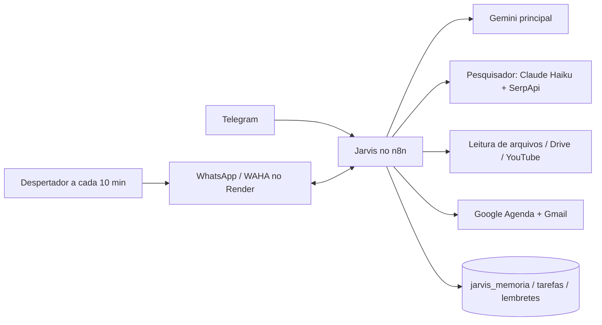

# Arquitetura — estado atual (05/11/2026)

Inventário do que já funciona. Fonte: kickoff, seção 2. Itens marcados ⚠ ainda precisam de confirmação do dono.

## Peças

| Peça | O que é | Onde roda |
| --- | --- | --- |
| n8n cloud | Orquestrador, conectado ao Claude via MCP | https://mauriciosrn8n.app.n8n.cloud |
| Jarvis - Fase 1 | Telegram → Claude → Telegram | n8n |
| WAHA | API de WhatsApp (repositório `MauricioSUprir/jarvis-waha`) | Render grátis, https://jarvis-waha.onrender.com |
| Jarvis - Despertador WhatsApp | Acorda o WAHA a cada 10 min | n8n |
| Ferramenta "WhatsApp - Enviar mensagem" | Ligada ao Jarvis | n8n |
| Gemini | Modelo principal | API |
| Pesquisador | Claude Haiku + SerpApi | n8n / API |
| Leitura de arquivos | PDF, Word, PowerPoint, Excel, fotos, vídeos (Telegram e Drive), YouTube, links | n8n |
| Google Agenda e Gmail | Inclui posts do Classroom que chegam por e-mail | n8n |
| Memória simples | Tabelas do n8n `jarvis_memoria`, `jarvis_tarefas`, `jarvis_lembretes` | n8n |

## Como conversam

## Limites de dependências gratuitas (plano B obrigatório)

- ⚠ Render grátis: o serviço dorme sem tráfego; por isso o Despertador. Plano B: ver pendências abaixo.
- ⚠ Limites do plano grátis do Gemini, SerpApi e n8n cloud: a levantar e registrar aqui.

## Pendências de levantamento

- Lista exata de workflows e ferramentas ligadas ao Jarvis.
- Prompt de sistema atual de cada agente (para `prompts/`).
