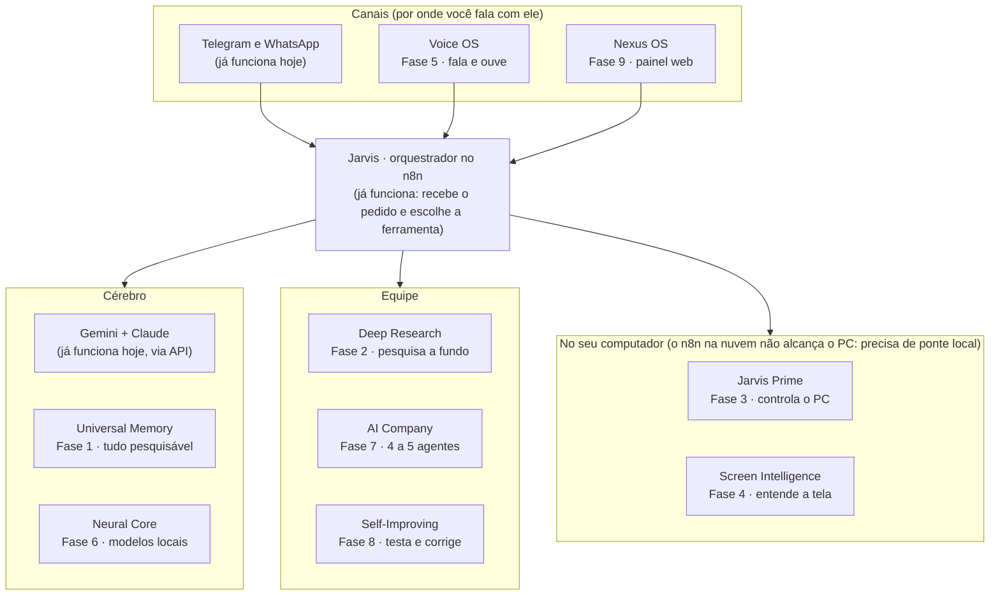

# Jarvis — Arquitetura e Roadmap dos 9 Projetos

*Atualizado em 05/11/2026*

Os 9 projetos não são 9 sistemas: são peças de um só, o Jarvis que já roda no n8n. A ordem é memória primeiro, depois pesquisa, mãos no PC, visão, voz, cérebro local, equipe, auto-melhoria e painel.

---

## Visão geral

Tudo entra pelos canais, passa pelo Jarvis, e ele aciona o cérebro, a equipe ou o agente no seu PC. O número da fase diz a ordem de construção.

**As 4 camadas, em texto:**

| Camada | Projetos | Onde roda |
| --- | --- | --- |
| Canais | Telegram/WhatsApp (já existe), Voice OS, Nexus OS | Celular, PC, navegador |
| Orquestrador | Jarvis (já existe) | n8n na nuvem |
| Cérebro | Gemini + Claude (já existe), Universal Memory, Neural Core | APIs + banco vetorial + PC (modelos locais) |
| Equipe | Deep Research, AI Company, Self-Improving | n8n / Python |
| No seu computador | Jarvis Prime, Screen Intelligence | Agente local instalado no PC |

---

## Os 9 projetos

Ordenados pela fase em que entram. Dificuldade = esforço para quem não é programador, com o Claude como copiloto.

| Fase | Projeto | O que é na prática | Dificuldade | Base pronta, para não reinventar |
| --- | --- | --- | --- | --- |
| 1 | Universal Memory | Banco que guarda tudo com data, origem e assunto; você pergunta e ele acha | Média | n8n + [Supabase](https://supabase.com) (pgvector) ou [Qdrant](https://qdrant.tech) |
| 2 | Deep Research | Planeja perguntas, busca, lê as páginas, cruza e entrega relatório com fontes | Média | [GPT Researcher](https://github.com/assafelovic/gpt-researcher), [Open Deep Research](https://github.com/langchain-ai/open_deep_research) |
| 3 | Jarvis Prime | Agente instalado no PC que abre apps, organiza arquivos e roda código | Alta | [Claude Desktop](https://claude.ai/download) com computer use, [UI-TARS Desktop](https://github.com/bytedance/UI-TARS-desktop), agent-desktop (Vercel Labs) |
| 4 | Screen Intelligence | Atalho que tira print e manda para um modelo de visão explicar | Baixa | Visão do Gemini e do Claude, que o Jarvis já usa |
| 5 | Voice OS | Palavra de ativação, transcrição e resposta falada | Média | [whisper.cpp](https://github.com/ggml-org/whisper.cpp), [ElevenLabs](https://elevenlabs.io), [Kokoro](https://huggingface.co/hexgrad/Kokoro-82M) |
| 6 | Neural Core | Chat próprio com modelos rodando no seu computador | Média, depende da placa de vídeo | [Ollama](https://ollama.com) + [Open WebUI](https://openwebui.com), modelos Qwen3 ou Gemma 4 |
| 7 | AI Company | Um diretor que divide a tarefa entre 4 a 5 agentes especialistas | Alta, e o custo de API sobe rápido | [CrewAI](https://www.crewai.com) ou [LangGraph](https://www.langchain.com/langgraph) |
| 8 | Self-Improving | Bateria de testes semanal; a IA propõe correção e só aplica com seu OK | Alta | [Claude Code](https://claude.com/claude-code) + workflows salvos no GitHub |
| 9 | Nexus OS | Painel web do Jarvis, não um sistema operacional | Média como painel; anos de trabalho como SO | Página web simples hospedada no Render |

Dois ajustes de escopo: a AI Company começa com 4 a 5 agentes, não 20, porque cada agente a mais multiplica tokens e custo. O Nexus OS vira painel, porque um desktop próprio dá muito trabalho e pouco ganho sobre Windows ou Mac.

---

## Ordem de construção

Cada fase entrega algo que funciona sozinho. A seguinte só começa quando o critério de pronto da anterior passa.

1. **Fase 1 — Universal Memory.** Tudo que entra no Jarvis (PDFs, Drive, anotações, conversas, tarefas) vai para um banco vetorial com data, origem e projeto.
    - Pronto quando: “onde está aquele projeto que comecei em agosto?” volta o arquivo certo, com link e histórico.
    - Vem primeiro porque pesquisa, equipe e auto-melhoria precisam lembrar o que já foi feito.
2. **Fase 2 — Deep Research.** O Pesquisador que já existe (Claude Haiku + SerpApi) ganha um fluxo: planeja perguntas, busca, lê as páginas inteiras, aponta contradições e escreve o relatório.
    - Pronto quando: um pedido no Telegram devolve relatório com fontes clicáveis, salvo no Drive e na memória.
    - Atalho: testar o GPT Researcher antes de montar do zero.
3. **Fase 3 — Jarvis Prime (mãos no PC).** O n8n na nuvem não alcança seu computador, então entra um agente local que recebe ordens do Jarvis.
    - Começa por arquivos e terminal; cliques em aplicativos vêm depois.
    - Caminho sem código: Claude Desktop com computer use. Caminho próprio: servidor MCP open source instalado no PC.
    - Pronto quando: “organiza a pasta X e prepara o ambiente do projeto Y” roda inteiro, pedindo OK antes de apagar.
4. **Fase 4 — Screen Intelligence.** Um atalho de teclado tira print, manda para o modelo de visão e a explicação chega no Telegram.
    - Pronto quando: o print de uma mensagem de erro volta com a causa e o próximo passo.
    - Depois vira os olhos do agente da Fase 3.
5. **Fase 5 — Voice OS.** Palavra de ativação “Jarvis”, transcrição local com whisper.cpp e resposta com a voz da ElevenLabs.
    - Fica depois das outras interfaces, como a voz já estava programada para o fim.
    - Pronto quando: “abre meu editor e mostra os erros do projeto mais recente” funciona falado.
6. **Fase 6 — Neural Core.** Ollama + Open WebUI no PC viram um terceiro cérebro, para assuntos privados e tarefas simples sem custo de API.
    - Gemini e Claude continuam nas tarefas pesadas: modelos locais ainda são mais fracos.
    - Modelos de 7–8B rodam em notebook com 16 GB de RAM; os médios pedem placa de vídeo com 16–24 GB.
7. **Fase 7 — AI Company.** O time do Deep Research vira modelo: diretor, pesquisador, programador e revisor, com você aprovando o plano antes da execução.
    - Pronto quando: uma tarefa de vários passos sai com plano aprovado, execução e revisão registradas.
8. **Fase 8 — Self-Improving.** Uma lista de cerca de 30 tarefas reais, com resposta esperada, roda toda semana e gera nota.
    - O Claude Code propõe correções nos workflows salvos no GitHub, roda os testes e espera seu OK.
    - Fica no fim porque precisa de histórico de erros reais para ter o que melhorar.
9. **Fase 9 — Nexus OS.** Painel web com conversas, memória, tarefas, status dos agentes e aprovações pendentes num lugar só.

---

## Regras de segurança

Valem antes da Fase 3, porque tudo que aparece na tela ou numa página pode trazer instrução maliciosa.

- Pasta liberada: o agente local só altera arquivos dentro dela; o resto do PC é só leitura.
- OK obrigatório para apagar, enviar mensagem ou e-mail em seu nome, comprar ou pagar.
- Banco e senhas ficam fora do controle de tela; leitura bancária só por extrato exportado.
- Texto vindo de tela, site ou documento é dado, nunca ordem.
- Cada ação fica num log, para saber o que foi feito e desfazer.
- Primeiros testes numa máquina virtual, sem senhas salvas.

---

## Decisões em aberto

- [ ] Computador: Windows ou Mac, quanta RAM e qual placa de vídeo? Define as Fases 3 e 6.
- [ ] Banco da memória: Supabase (plano grátis, recomendado) ou Qdrant?
- [ ] Orçamento mensal de API (Claude, Gemini, ElevenLabs, SerpApi): define quantos agentes e quanto roda local.
- [ ] Lista do que o Jarvis pode fazer sem perguntar.

---

## Primeira semana: Fase 1

- [ ] Criar projeto no [Supabase](https://supabase.com) e ativar a extensão pgvector
- [ ] No n8n, criar o workflow “Jarvis - Memória Universal”: recebe texto ou arquivo, gera embedding e grava com data, origem e projeto
- [ ] Indexar a pasta do Drive e os arquivos que já passaram pelo Jarvis
- [ ] Ligar a ferramenta “Buscar na memória” no Jarvis, mantendo as tabelas jarvis_memoria, jarvis_tarefas e jarvis_lembretes
- [ ] Testar: “onde está o projeto que comecei em agosto?”

---

## Fontes

- [Hugging Face — melhores LLMs para rodar local em 2026](https://huggingface.co/blog/daya-shankar/open-source-llm-models-to-run-locally)
- [Cut the SaaS — ferramentas e hardware para LLM local](https://cut-the-saas.com/the-cut/best-local-llm-tools)
- [PromptQuorum — modelos do Ollama, junho de 2026](https://www.promptquorum.com/local-llms/top-open-source-models-ollama)
- [Pinggy — controlar o computador com agentes de IA, setembro de 2026](https://pinggy.io/blog/control_computer_with_ai_agents/)
- [Emergent — Vercel Labs lança o agent-desktop, novembro de 2026](https://emergent.sh/news/vercel-labs-releases-agent-desktop-agent)
- [Ry Walker — GPT Researcher](https://rywalker.com/research/gpt-researcher)
- [LangChain — Open Deep Research](https://github.com/langchain-ai/open_deep_research)
- [FutureAGI — CrewAI vs LangGraph vs AutoGen](https://futureagi.com/blog/crewai-vs-langgraph-vs-autogen-2026)
- [Noqta — custo de frameworks multiagente](https://noqta.tn/blog/ai-agent-frameworks-langgraph-crewai-openai-sdk-comparison-2026)
- [Pasquale Pillitteri — voz local: Whisper, Kokoro e outros](https://pasqualepillitteri.it/en/news/28184/local-voice-ai-text-to-speech-speech-to-text)
