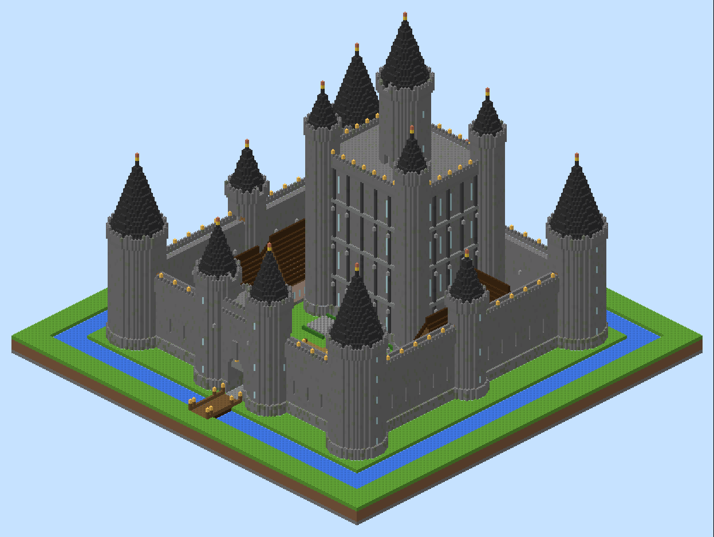
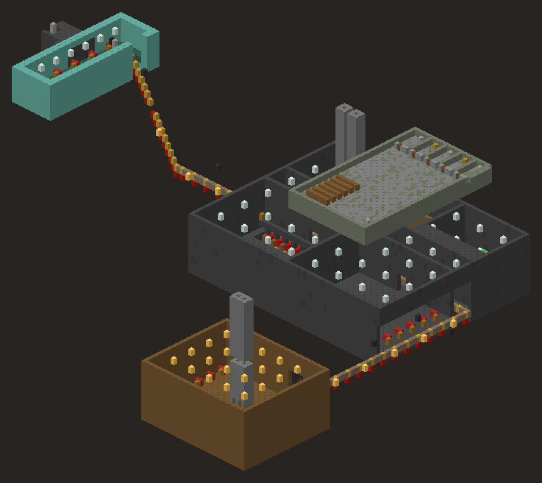
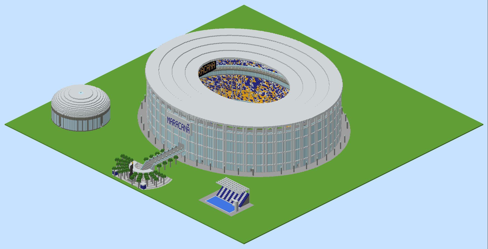
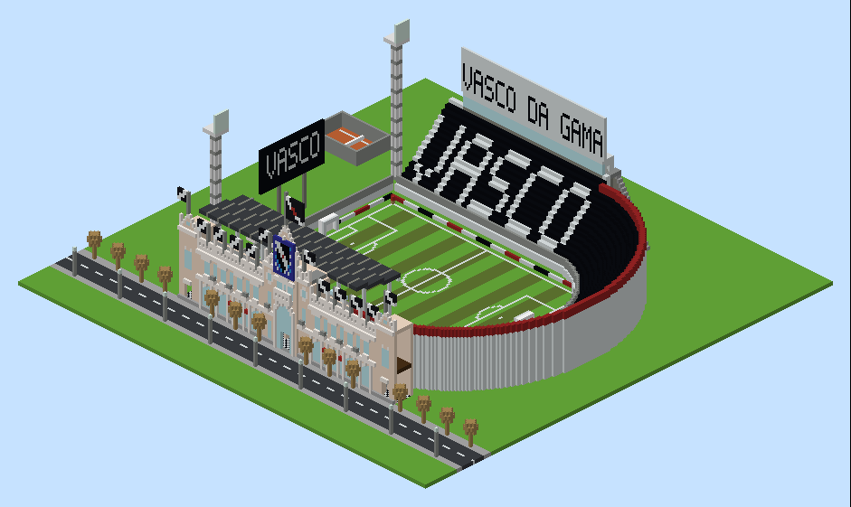

# Castelo Enorme para Minecraft

Um castelo gigante (≈200 × 200 blocos) com cômodos mobiliados, **três bases secretas
subterrâneas** ligadas por um **metrô** e vários **sistemas de redstone**, tudo gerado por
código e **testado automaticamente num servidor Minecraft de verdade**.



Funciona no **Minecraft Java Edition 1.21 ou mais novo** (testado em 1.21.1, 1.21.11 e 26.3) e
no **Bedrock** (PlayStation, Xbox, Switch, celular), por meio de um servidor com o mundo pronto
(testado no servidor oficial 1.26.52).

> **Joga no PlayStation?** Veja o passo a passo em [COMO_JOGAR_NO_PLAYSTATION.md](COMO_JOGAR_NO_PLAYSTATION.md).

## Como colocar no seu mundo

### Opção 1: datapack (sem mods)

1. Abra o Minecraft → *Um jogador* → selecione o mundo → **Editar** → **Abrir pasta do mundo**.
2. Copie `saida/castelo_datapack.zip` para dentro da pasta `datapacks` desse mundo.
3. Entre no mundo (com comandos/trapaças ativados) e digite `/reload`.
4. Vá para um lugar **aberto e plano**, olhe para o **norte** e digite:

   ```
   /function castelo:construir
   ```

O castelo aparece **à sua frente (ao norte)**: você fica em frente à ponte levadiça.
A construção leva alguns segundos e mostra o progresso no chat.

> **Atenção:** a área de ~200 × 200 blocos à sua frente é substituída, e as bases descem
> **34 blocos abaixo** de onde você está. Use num mundo normal (não superplano), em pé na
> superfície, e de preferência faça um backup do mundo antes.

### Opção 2: WorldEdit / FAWE

Copie `saida/castelo.schem` para `config/worldedit/schematics/`, fique no lugar desejado e use
`//schem load castelo` e depois `//paste`. O ponto de cola é o mesmo do datapack.

### Opção 3: Bedrock / PlayStation

`saida/Castelo_PlayStation.zip` traz o **mundo Bedrock já construído** (com os baús cheios) e um
`server.properties`. Ele roda no servidor oficial gratuito da Mojang, e consoles entram por
"Jogos em LAN" com a ajuda do app BedrockTogether. Guia: [COMO_JOGAR_NO_PLAYSTATION.md](COMO_JOGAR_NO_PLAYSTATION.md).

### Opção 4: comandos

`saida/comandos_java.txt` tem todos os ~18 mil comandos (`/fill` e `/setblock`) em ordem,
relativos à posição do jogador. É útil para estudar ou usar em blocos de comando.

## O que tem no castelo

- **Fosso** com água ao redor e **ponte levadiça** baixada.
- **Muralhas** de 20 blocos com passadiço, ameias, seteiras e escadas de acesso.
- **7 torres** (4 de canto, 3 no meio das muralhas) com andares, escadas de mão e telhados cônicos.
- **Guarita** com grade levadiça, sala dos guardas e balcão com mata-cães.
- **Torre de menagem** com 4 andares e uma grande torre central:
  - **Térreo:** salão do trono, cozinha, sala de jantar, arsenal e sala da guarda
    (com alçapão para a **masmorra**: celas e adega).
  - **1º andar:** biblioteca e escritório do rei.
  - **2º andar:** aposentos do rei, da rainha e quartos de hóspedes.
  - **3º andar:** salão de festas, capela real e uma "sala do tesouro" (de mentira...).
- **Pátio:** capela, quartel, ferreiro, estábulo, taverna, fazenda, casinhas, fontes, árvores,
  jardins com cercas-vivas e flores, bancos, o **poço** e **postes que acendem sozinhos à noite**.
- **Decoração:** estandartes coloridos na torre e nas muralhas, tapetes, vasos de flores, velas,
  lustres de lanterna, vitrais na capela e atrás do trono.

## Equipamentos e tesouros

Os baús se enchem **na primeira vez que alguém abre** (usam tabelas de loot do datapack, o
que funciona igual em todas as versões 1.21+). Por isso, **mantenha o datapack instalado**:
sem ele os baús ficam vazios (inclusive se você usar o `.schem`).

| Onde | O que tem |
|---|---|
| **Bases secretas** (QG, Refúgio, Submarina) e **aposentos do rei** | Kit completo de **netherite** com os melhores encantamentos: armadura com Proteção IV, Inquebrável III e Remendo (+ Respiração, Afinidade Aquática, Peso-Pena IV, Passos Profundos, Velocidade das Almas e Agachamento Ágil); espada com Afiação V, Saque III, Aspecto Flamejante II, Alcance Ampliado III; machado, picareta (Fortuna III), pá (Toque Suave), arco (Força V, Infinidade, Chama, Impacto II), besta (Carga Rápida III, Disparo Múltiplo), tridente (Lealdade III, Canalização, Empalamento V), **maça** (Densidade V, Rajada de Vento III), escudo e **élitros** |
| Bases secretas | Suprimentos de batalha: **totens da imortalidade**, **maçãs douradas encantadas**, poções (cura II, força II, regeneração II, mestre tartaruga, resistência ao fogo...), pérolas do End, fogos de artifício, cristais do End |
| **Cofre do QG** | Tesouro: diamantes, netherite, blocos de ouro, esmeraldas, maçãs encantadas, totens, élitros, estrela do Nether, sinalizador, caixas de shulker |
| Arsenal da torre | Armaduras e espada de **diamante** encantadas, arcos, flechas |
| Quartel | Equipamento de ferro para os soldados |
| Biblioteca | **Livros encantados** (Remendo, Proteção IV, Afiação V, Eficiência V, Fortuna III...) e frascos de experiência |
| Quartos de hóspedes e bases | Poções |
| Cozinha, taverna e bases | Comida |
| Ferreiro | Lingotes, diamantes, netherite e moldes de melhoria |

## Bases secretas (spoiler!)



| Base | Onde | Como entrar |
|---|---|---|
| **QG Secreto do Rei** | embaixo da torre de menagem | Na **biblioteca (1º andar)**, coloque um **livro** no **atril** perto da parede oeste: a estante se abre. Lá dentro, pule no **elevador de bolhas** que desce (o da direita). |
| **Refúgio do Poço** | embaixo do pátio sudeste | Pule no **poço** (no buraco da direita): a água te puxa para baixo. O da esquerda te leva de volta para cima. |
| **Base Submarina** | embaixo do fosso oeste, com **teto de vidro** mostrando a água | De **metrô** a partir do QG, ou pela **escotilha escondida** num arbusto do lado de fora do fosso, a oeste. |

Por dentro da sala secreta, uma **alavanca** ao lado da estante abre a porta para sair.

## Sistemas de redstone

| Sistema | Onde | Como usar |
|---|---|---|
| **Porta secreta da estante** | Biblioteca | Livro no atril → dois pistões grudentos puxam as estantes (uma para o chão, outra para o teto). Tire o livro e ela fecha. |
| **Cofre com senha** | QG, sala do cofre | 6 alavancas. A porta de ferro só abre com a senha **ligada, desligada, ligada, ligada, desligada, ligada** (da esquerda para a direita). Qualquer erro mantém a porta fechada. Botão por dentro para sair. |
| **Separador automático de itens** | QG, armazém | Jogue tudo no **baú de entrada**: pedregulho, ferro, ouro, diamante, redstone, carvão, esmeralda e lápis vão cada um para o seu barril; o resto vai para o barril de sobras. *Não tire os itens dos funis-filtro.* |
| **Metrô secreto** | QG ↔ Base Submarina e QG ↔ Refúgio do Poço | Entre no carrinho na estação e aperte o **botão** à frente: ele dispara e para sozinho na outra estação (inclui uma rampa de 15 blocos e uma curva). |
| **Elevadores de bolhas** | QG ↔ sala secreta (38 blocos) e Refúgio ↔ poço | Areia das almas sobe, magma desce. As portas abertas seguram a água. |
| **Alarme com armadilha** | Túnel de fuga da Base Submarina | Quem cruzar o fio de armadilha faz o **sino tocar**, acende as **lâmpadas** e os **dispensers atiram flechas**. Use uma **tesoura** no fio para desarmar. |
| **Postes automáticos** | Caminho do pátio | Sensores de luz invertidos acendem as lâmpadas ao anoitecer. |

## Estádios: Maracanã e São Januário (só no mundo Bedrock / PlayStation)

O mundo Bedrock (`Castelo_PlayStation.zip` e `Castelo.mcworld`) também traz **dois estádios em
tamanho real** (1 bloco = 1 metro), feitos a partir de fotos e plantas dos estádios de verdade.
Uma **estrada** sai da frente do castelo: as placas mostram o caminho.

| | Maracanã | São Januário |
|---|---|---|
| Onde | ~400 blocos a **leste** do castelo | ~250 blocos a **oeste** do castelo |
| Por fora | Oval de 316 x 272 m, fachada de pilares e vidro, cobertura branca, esplanada com postes, **passarela elevada** saindo da praça com palmeiras e rotunda, **estátua do Bellini** com a taça, bilheterias, **Maracanãzinho** e **parque aquático** com torre de saltos | **Fachada neocolonial** de 118 m com o frontão de azulejos e o escudo, portão em arco, sacada, pináculos e bandeiras do Vasco, rua com árvores, **torres de luz**, **placar**, **estátua do Romário**, quadra de tênis |
| Arquibancadas | Anel único com cadeiras amarelas, azuis e brancas, anel de **camarotes**, vomitórios, telões | Social coberta, **curva com a Cruz de Malta**, arquibancada preta com **VASCO** escrito |
| Por dentro | 4 níveis de circulação com escadarias, catracas, lanchonetes e banheiros; **tribuna de imprensa**, **tribuna de honra** e **cabines de rádio/TV**; **vestiários**, túnel, **zona mista** e **sala de coletiva** | Saguão com azulejos, **sala de troféus**, **loja**, **salão nobre**, **sala de imprensa**, **presidência**, terraço, **cabines de imprensa** no alto, **vestiários**, sala do árbitro e túnel |




## Como funciona o código

| Arquivo | O que faz |
|---|---|
| `gerar_castelo.py` | Programa principal: monta o modelo e gera os arquivos em `saida/`. |
| `modelo.py` | A grade 3D de blocos e as primitivas de desenho. |
| `castelo.py` | Tudo acima do chão (muralhas, torres, cômodos, pátio). |
| `bases.py` | Tudo embaixo da terra (bases, masmorra, metrô, elevadores). |
| `redstone.py` | Os sistemas de redstone, cada um com um roteiro de teste. |
| `equipamentos.py` | Os itens dos baús (tabelas de loot). |
| `exportar.py` | Converte o modelo em comandos otimizados, datapack e schematic. |
| `estadios.py` | O Maracanã, São Januário e a estrada (`python3 estadios.py` gera as prévias). |
| `previa.py` | As imagens de prévia. |
| `testar_no_servidor.py` | Sobe um servidor Minecraft oficial e testa tudo. |
| `bedrock.py` | Traduz os blocos e o loot para o formato Bedrock. |
| `construir_mundo_bedrock.py` | Constrói o mundo Bedrock (castelo, estádios e estrada) num servidor oficial e empacota (`--testar` roda os testes). |
| `testar_bedrock.py` | Testes do mundo Bedrock (blocos, redstone, metrô, baús). |

Para gerar de novo: `pip install numpy pillow` e `python3 gerar_castelo.py`.

### Testes automáticos

```
python3 testar_no_servidor.py sistemas 1.21.11   # cada sistema de redstone isolado
python3 testar_no_servidor.py castelo 1.21.11    # castelo inteiro: confere bloco a bloco
                                                 # e testa os sistemas no lugar
```

O testador baixa o `server.jar` oficial da Mojang, instala o datapack num mundo de teste,
constrói e então **aperta os botões de verdade**: coloca o livro no atril, mexe nas alavancas
do cofre, joga itens no separador, chama o carrinho do metrô, solta um item no fio do alarme
etc., conferindo se cada coisa reagiu como deveria. Versões 26.x precisam de Java 25
(`JAVA=/caminho/do/java python3 testar_no_servidor.py ...`).
